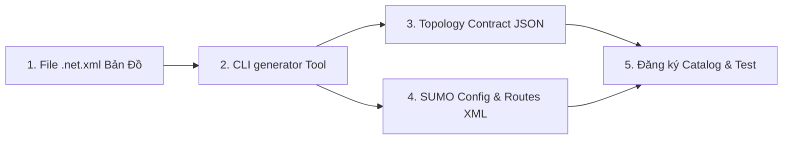

# Hướng Dẫn Đóng Gói Quy Trình Tạo Kịch Bản Giao Thông Mới (HCM Corridor Style)

Tài liệu này đóng gói quy trình chuẩn hóa từng bước để khởi tạo, cấu hình và tích hợp một **Kịch bản Giao thông Mô phỏng SUMO mới** (như `hcm_corridor`) vào hệ thống **EdgeFlow AI**.

---

## 📋 Tổng Quan Quy Trình

Quy trình đóng gói kịch bản bao gồm 5 công đoạn chính:



---

## 🛠️ 1. Chuẩn Bị File Mạng Lưới SUMO (`.net.xml`)

Bạn có thể chuẩn bị file bản đồ `.net.xml` bằng một trong các phương pháp:
- **Tải từ OpenStreetMap**: Sử dụng công cụ `osmWebWizard.py` của SUMO hoặc `netconvert`.
- **Dữ liệu Camera TP.HCM**: Trích xuất mạng lưới từ crawler [src/crawler/hcm_traffic_crawler.py](file:///e:/vedc-traffic-flow/src/crawler/hcm_traffic_crawler.py) và [src/graph/camera_graph_builder.py](file:///e:/vedc-traffic-flow/src/graph/camera_graph_builder.py).
- **File có sẵn**: Đặt file mạng lưới tại `data/raw/<my_scenario_id>.net.xml`.

---

## ⚡ 2. Sinh Kịch Bản Tự Động Với CLI Generator Tool

Dự án cung cấp công cụ tự động hóa tại [src/tools/generate_traffic_scenario.py](file:///e:/vedc-traffic-flow/src/tools/generate_traffic_scenario.py).

### Lệnh khởi tạo:
```bash
python src/tools/generate_traffic_scenario.py \
  --net data/raw/my_scenario_id.net.xml \
  --scenario-id my_scenario_id \
  --vehicles 1500 \
  --duration 3600
```

### 📊 Tỉ lệ Phân bổ Phương tiện Chuẩn TP.HCM (Default Modal Split)
Tool tự động tạo ra lưu lượng giao thông thực tế của đô thị Việt Nam:
- 🛵 **Motorcycle (Xe máy)**: 65%
- 🚗 **Car (Ô tô cá nhân)**: 25%
- 🚕 **Taxi**: 4%
- 🚌 **Bus (Xe buýt)**: 3%
- 🚚 **Truck (Xe tải)**: 3%

---

## 📁 3. Các Tệp Tin Được Tự Động Sinh Ra

Sau khi chạy xong lệnh, các tệp tin cấu hình sẽ tự động được sinh tại đúng vị trí chuẩn kiến trúc EdgeFlow AI:

1. **Topology Contract**:
   - Path: [contracts/topology/my_scenario_id.json](file:///e:/vedc-traffic-flow/contracts/topology/)
   - Chứa danh sách các nút giao ($V$), cạnh đường ($E$), các pha đèn (phases) và hướng di chuyển (movements).

2. **Cấu Hình SUMO Simulation**:
   - Folder: [services/simulator/sumo_configs/my_scenario_id/](file:///e:/vedc-traffic-flow/services/simulator/sumo_configs/)
   - `my_scenario_id.net.xml`: File bản đồ mạng lưới.
   - `my_scenario_id.rou.xml`: File tuyến đường của từng phương tiện.
   - `my_scenario_id.sumocfg`: File cấu hình chính của SUMO.
   - `gui-settings.xml` & raster icons (`motorcycle.png`, `car.png`, `bus.png`, `truck.png`, `taxi.png`).

3. **Cập nhật Biến Môi Trường**:
   - Tự động cập nhật `EDGEFLOW_TOPOLOGY=my_scenario_id` trong file [.env](file:///e:/vedc-traffic-flow/.env).

---

## 📝 4. Đăng Ký Profile Kịch Bản (Scenario Registry)

Mở file [contracts/scenarios.py](file:///e:/vedc-traffic-flow/contracts/scenarios.py) và khai báo thông tin kịch bản mới vào `CANONICAL_SCENARIOS`:

```python
CANONICAL_SCENARIOS["my_scenario_id"] = ScenarioProfile(
    scenario_id="my_scenario_id",
    name="Tên Kịch Bản Mới TP.HCM",
    description="Mô tả khu vực và đặc điểm lưu lượng giao thông...",
    flow_rates={},
    default_duration_s=3600,
    category="realworld",  # "synthetic", "benchmark", hoặc "realworld"
    supported_topologies=["my_scenario_id"],
)
```

---

## 🧪 5. Kiểm Minh & Chạy Chương Trình

### Run Unit & Contract Tests:
```bash
python -m pytest tests/unit/test_contracts.py tests/unit/test_generate_traffic_scenario.py
```

### Khởi Chạy Mô Phỏng Trực Tiếp (GUI / Controller):
```bash
# Khởi chạy giao diện thử nghiệm với kịch bản mới
python run_experiment_gui.py --scenario my_scenario_id
```

---

## 💡 Mẹo & Lưu Ý (Best Practices)
1. **Schema Authority**: Luôn đảm bảo ID kịch bản viết thường, không chứa khoảng trắng (ví dụ: `hcm_corridor`, `district1_grid`).
2. **Deterministic Seed**: Bạn có thể truyền flag `--seed 123` vào CLI generator để đảm bảo kịch bản tái lập được chính xác trong các bài test benchmark.
