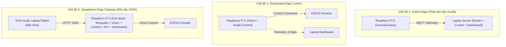

# Hướng Dẫn Triển Khai Docker Phân Tán Trên Raspberry Pi 5 (EdgeFlow AI)

Tài liệu này hướng dẫn chi tiết cách chạy hệ thống **EdgeFlow AI** trên **Raspberry Pi 5** theo mô hình tính toán phân tán (**Distributed Edge Architecture**) phục vụ trình diễn sa bàn thực tế hoặc triển khai độc lập tại nút giao thông.

---

## 1. Các Mô Hình Triển Khai (Deployment Modes)

Tùy thuộc vào kịch bản demo hoặc thực địa, file [`docker-compose.rpi.yml`](file:///e:/vedc-traffic-flow/docker-compose.rpi.yml) hỗ trợ 4 chế độ vận hành chính thông qua Docker Compose Profiles:



---

## 2. Chuẩn Bị & Cấu Hình Môi Trường (.env.rpi)

Trên Raspberry Pi 5, sao chép file cấu hình mẫu:
```bash
cp .env.rpi.example .env.rpi
```

### Các thông số quan trọng cần chỉnh sửa:
```ini
# IP của máy chủ Laptop chạy Mosquitto Broker (nếu chạy phân tán)
MQTT_HOST=192.168.1.100
MQTT_PORT=1883

# ID nút giao mà Camera Raspberry Pi đang quan sát trên bản đồ đồ thị
VISION_NODE_ID=J1

# Nguồn video: '0' hoặc '/dev/video0' (USB Cam), 'picamera' (Camera Module 3), 'synthetic' (Test pattern)
VIDEO_SOURCE=/dev/video0
VISION_FPS=10.0

# Trọng số mô hình AI (chạy ONNX Runtime / OpenCV DNN trên Pi 5)
DETECTION_MODEL_PATH=models/yolov8n.onnx
CONFIDENCE_THRESHOLD=0.4

# Giám sát phần cứng: Bật đọc nhiệt độ CPU và tình trạng throttling của Pi 5
ENABLE_HARDWARE_TELEMETRY=true
```

---

## 3. Lệnh Khởi Chạy Từng Chế Độ

### Chế độ 1: Vision Edge Perception (Mặc định cho Sa bàn VEDC 2026)
Chỉ chạy dịch vụ thị giác máy tính trên Pi 5. Toàn bộ hàng đợi xe từ camera được trích xuất và gửi về MQTT Broker trung tâm trên Laptop:
```bash
docker compose -f docker-compose.rpi.yml --profile vision up -d
```
*Xem log thị giác và FPS:*
```bash
docker logs -f edgeflow-rpi-vision
```

---

### Chế độ 2: Distributed Edge Control (Xử lý điều khiển biên)
Chạy cả **Vision** và **Graph-Control** cục bộ trên Pi 5. Pi 5 tự tính toán thuật toán Max-Pressure / RL và trực tiếp phát lệnh điều khiển đến ESP32:
```bash
docker compose -f docker-compose.rpi.yml --profile edge-node up -d
```

---

### Chế độ 3: Standalone Edge Gateway (Độc lập không cần Laptop Server)
Khởi chạy toàn bộ hệ sinh thái (Local MQTT Broker + Vision + Graph-Control + REST/WS API + React Dashboard) trực tiếp trên Raspberry Pi 5:
```bash
docker compose -f docker-compose.rpi.yml --profile standalone up -d
```
*Truy cập bảng điều khiển:*
- **React IOC Dashboard**: `http://<ip-cua-raspberry-pi>:3000`
- **Swagger REST API**: `http://<ip-cua-raspberry-pi>:8000/docs`

---

### Chế độ 4: Edge Management Stack (Control + API + Dashboard)
Dành cho trường hợp Pi 5 đóng vai trò trung tâm điều hành và hiển thị giao diện, nhận dữ liệu camera từ các nguồn khác:
```bash
docker compose -f docker-compose.rpi.yml --profile management up -d
```

---

## 4. Dừng & Khởi Động Lại Dịch Vụ

- **Dừng toàn bộ container đang chạy:**
  ```bash
  docker compose -f docker-compose.rpi.yml down
  ```
- **Khởi động lại một dịch vụ cụ thể (ví dụ Vision):**
  ```bash
  docker compose -f docker-compose.rpi.yml restart vision
  ```

---

## 5. Quyền Truy Cập Phần Cứng & Khắc Phục Sự Cố

1. **Quyền truy cập Camera USB / V4L2 (`/dev/video*`)**:
   Nếu container không đọc được camera, cấp quyền người dùng vào nhóm `video`:
   ```bash
   sudo usermod -aG video $USER
   sudo chmod 666 /dev/video*
   ```

2. **Truy cập Cảm biến Nhiệt độ CPU Pi 5**:
   File `docker-compose.rpi.yml` đã mount sẵn `/sys/class/thermal:/sys/class/thermal:ro`. Container sẽ tự động công bố nhiệt độ định kỳ lên topic `edgeflow/v1/health/vision`.

3. **Kiểm tra kết nối mạng giữa Pi và Laptop**:
   ```bash
   ping 192.168.1.100
   nc -zv 192.168.1.100 1883
   ```
