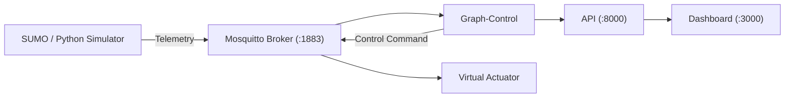
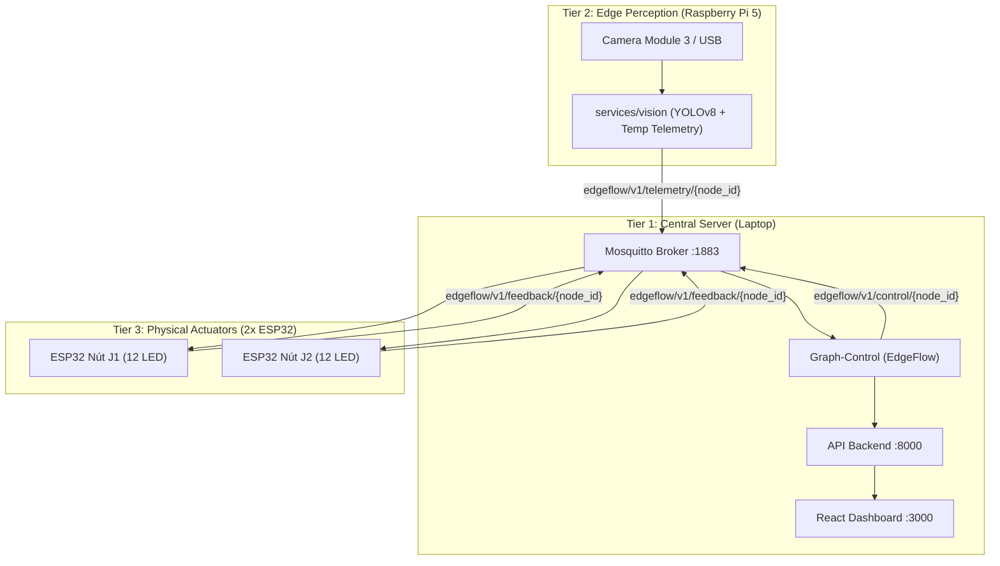
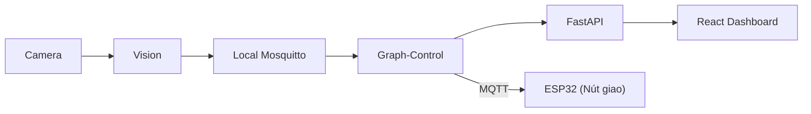

# EdgeFlow AI — Hướng Dẫn Chi Tiết Các Chế Độ Vận Hành (Run Modes)

Tài liệu này tổng hợp toàn bộ các **chế độ vận hành (Run Modes)** của hệ thống **EdgeFlow AI**, từ môi trường mô phỏng Digital Twin thuần túy, thử nghiệm huấn luyện giải thuật, cho đến hệ thống phân tán thực địa và trình diễn sa bàn thực tế tại VEDC 2026.

---

## 🗺️ Bảng Tổng Hợp Các Chế Độ Chạy

| Chế độ | Thiết bị sử dụng | Dịch vụ khởi chạy | Mục đích sử dụng |
|---|---|---|---|
| **Mode 1: Pure Simulation (Digital Twin)** | Laptop Server | Broker + Simulator + Control + API + Dashboard + Actuator | Phát triển giải thuật, kiểm thử toàn bộ trên máy tính không cần phần cứng |
| **Mode 2: 3-Tier Distributed Demo (Khuyến nghị VEDC)** | Laptop + Raspberry Pi + 2x ESP32 | **Laptop**: Broker, Control, API, Dashboard<br>**Pi 5**: Vision Perception<br>**ESP32**: Firmware chấp hành | Trình diễn sa bàn thực tế với Ban giám khảo |
| **Mode 3: Distributed Edge Control** | Raspberry Pi + ESP32 (+ Laptop) | **Pi 5**: Vision + Graph-Control cục bộ<br>**ESP32**: Firmware chấp hành | Vận hành biên phân tán độc lập, không phụ thuộc vào máy chủ |
| **Mode 4: Standalone Edge Gateway** | Raspberry Pi 5 (Standalone) | **Pi 5**: Broker + Vision + Control + API + Dashboard | Chạy trọn gói toàn bộ hệ thống trên duy nhất 1 board Pi (kèm màn hình) |
| **Mode 5: Experiment & Benchmark** | Laptop Server | Broker + Simulator + Control + Experiment Runner | Chạy các kịch bản so sánh hiệu năng (Fixed-Time vs Max-Pressure vs RL) |
| **Mode 6: Hardware Failsafe / Safe-Stop** | ESP32 | Firmware tự động kích hoạt khi mất kết nối > 15s hoặc nút bấm GPIO 4 | Đảm bảo an toàn giao thông tuyệt đối (Vàng chớp tắt / All-Red) |

---

## 1. Mode 1: Mô Phỏng Hoàn Toàn Trên Máy Tính (Pure Simulation)

*Toàn bộ dữ liệu giao thông được sinh tự động bởi SUMO Digital Twin hoặc Python Simulator tích hợp sẵn.*



### Cách khởi chạy:
```bash
# Trên Laptop (Docker):
docker-compose --profile simulation up -d

# Hoặc khởi chạy bằng Python cục bộ:
make run-server
```
- **Dashboard điều hành:** `http://localhost:3000`
- **Swagger REST API:** `http://localhost:8000/docs`

---

## 2. Mode 2: Hệ Thống Phân Tán 3 Tầng (3-Tier Distributed Demo)

*Chế độ tiêu chuẩn cho vòng Bán kết VEDC 2026 với Sa bàn vật lý 2 nút giao.*



### Cách khởi chạy:
1. **Bước 1: Khởi động Server trung tâm trên Laptop:**
   ```bash
   docker-compose --profile hardware up -d
   ```
2. **Bước 2: Khởi động Perception trên Raspberry Pi 5:**
   ```bash
   # Cách dùng Docker (khuyến nghị):
   docker compose -f docker-compose.rpi.yml --profile vision up -d

   # Hoặc chạy trực tiếp Python:
   cd services/vision && python main.py --video 0 --mqtt-host <IP_LAPTOP> --node-id J1
   ```
3. **Bước 3: Cấp nguồn 2 mạch ESP32:**
   - ESP32 tự kết nối WiFi và broker MQTT, nhận lệnh điều khiển và đồng bộ pha đèn sa bàn.

---

## 3. Mode 3: Điều Khiển Biên Cục Bộ (Distributed Edge Control)

*Raspberry Pi 5 đảm nhiệm cả việc nhận diện hình ảnh và tự chạy thuật toán điều khiển cục bộ (Decentralized Control), trực tiếp phát lệnh tới ESP32.*

### Ưu điểm:
- Không bị ảnh hưởng nếu mạng kết nối lên máy chủ bị ngắt quãng.
- Độ trễ điều khiển siêu thấp (< 10ms giữa Pi và ESP32 trên mạng nội bộ).

### Cách khởi chạy trên Raspberry Pi 5:
```bash
docker compose -f docker-compose.rpi.yml --profile edge-node up -d
```

---

## 4. Mode 4: Standalone Edge Gateway (Toàn Bộ Hệ Thống Trên Pi 5)

*Khởi chạy toàn bộ hệ thống (Broker, Vision, Control, API, Dashboard) trực tiếp trên Raspberry Pi 5 mà không cần đến máy Laptop.*



### Cách khởi chạy trên Raspberry Pi 5:
```bash
docker compose -f docker-compose.rpi.yml --profile standalone up -d
```
- **Truy cập Dashboard:** Mở trình duyệt trên Pi hoặc từ điện thoại/máy tính khác: `http://<ip-raspberry-pi>:3000`

---

## 5. Mode 5: Thí Nghiệm & Đánh Giá Hiệu Năng (Experiment & Benchmark)

*Chạy tự động các kịch bản so sánh hiệu năng giữa các giải thuật:*
- **Fixed-Time Baseline** (Chu kỳ cố định truyền thống).
- **Max-Pressure Algorithm** (Tối ưu hóa áp lực đồ thị giao thông).
- **Reinforcement Learning Agent** (DQN Inference).

### Cách khởi chạy:
```bash
# Chạy thí nghiệm qua Docker Experiment Runner:
docker-compose --profile experiment up -d

# Hoặc chạy kiểm thử so sánh trực tiếp bằng Python:
python src/tools/benchmark_models.py
```
Kết quả báo cáo và biểu đồ sẽ tự động xuất ra thư mục [`artifacts/`](file:///e:/vedc-traffic-flow/artifacts/) và [`output/`](file:///e:/vedc-traffic-flow/output/).

---

## 6. Mode 6: Cơ Chế Dự Phòng & An Toàn Phần Cứng (Hardware Failsafe)

*Các lớp phòng vệ an toàn được lập trình nhúng trực tiếp vào phần cứng ESP32 và State Machine:*

1. **Watchdog 15 giây**: Nếu mất kết nối MQTT hoặc không nhận được lệnh từ Control trong 15s, ESP32 tự động kích hoạt chu kỳ an toàn độc lập hoặc chớp vàng cảnh báo.
2. **Khoảng đệm an toàn bất biến**:
   - $\text{Vàng} = 3.0\text{s}$ bắt buộc trước khi chuyển Đỏ.
   - $\text{Đỏ toàn bộ (All-Red)} = 2.0\text{s}$ để giải phóng phương tiện trong giao lộ.
   - $\text{Thời gian Xanh tối thiểu} = 10.0\text{s}$ chống đổi pha liên tục gây xung đột.
3. **Nút bấm khẩn cấp Safe-Stop (GPIO 4)**: Nhấn nút phần cứng trên ESP32 sẽ lập tức đưa toàn bộ nút giao về trạng thái an toàn tuyệt đối và thông báo lỗi lên hệ thống.
