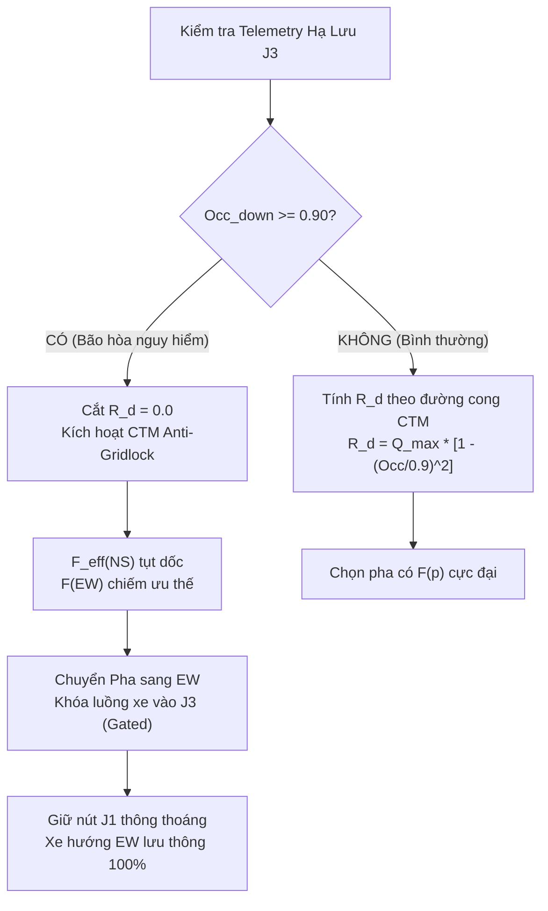

# BÁO CÁO KỸ THUẬT: THUẬT TOÁN ĐIỀU KHIỂN DÒNG GIAO THÔNG FLOWTHEORY
## (Cell Transmission Model, Multi-Hop Graph Bottleneck Lookahead & Anti-Gridlock Gating)

**Dự án**: EdgeFlow AI — Hệ thống Điều khiển Giao thông Thích ứng Đa nút Phân tán  
**Cuộc thi**: Vietnam Electronic Design Challenge (VEDC 2026)  
**Tác giả**: Đội ngũ Kỹ thuật EdgeFlow AI  
**Ngày cập nhật**: Tháng 11, 2026  

---

## 1. TÓM TẮT ĐIỀU HÀNH (EXECUTIVE SUMMARY)

Thuật toán **FlowTheory** (`FlowTheoryController`) là giải pháp điều khiển tín hiệu đèn giao thông thích ứng phân tán cốt lõi trong hệ thống **EdgeFlow AI**. Khác với các thuật toán tham lam (Greedy / Max-Queue) hay thuật toán áp lực thuần túy (Max-Pressure cổ điển), FlowTheory kết hợp nền tảng vật lý thủy động lực học dòng giao thông **CTM (Cell Transmission Model - Carlos F. Daganzo)** với lý thuyết đồ thị mạng lưới $G=(V, E)$.

### Các đặc tính kỹ thuật vượt trội:
1. **Mô hình hóa chính xác Cung - Cầu thời gian thực**: Cân bằng giữa nhu cầu xe dồn ứ ở thượng lưu (Sending Capacity $S_a$) và khả năng tiếp nhận thực tế của các nhánh hạ lưu (Receiving Capacity $R_d$).
2. **Cơ chế Chống Kẹt Cứng Mạng (Anti-Gridlock Gating)**: Khi một nhánh hạ lưu đạt ngưỡng bão hòa ($Occ \ge 90\%$), thuật toán chủ động ngắt quyền ưu tiên (Gating) của nhánh đổ về hướng đó. Điều này ngăn chặn hiện tượng đuôi xe tràn ngược (Spillback) gây kẹt cứng chữ thập nút giao (Deadlock), bảo vệ luồng xe cắt ngang được lưu thông bình thường.
3. **Dự báo Nút nghẽn Lan truyền 2-Hop (2-Hop Graph Lookahead)**: Giám sát mật độ và độ chiếm dụng của các nút giao cách 2 bước liên kết trên đồ thị mạng lưới ($G=(V, E)$), giúp phát hiện và điều tiết sớm trước khi sóng xung kích (Shockwave) ùn tắc kịp dội ngược về nút hiện tại.
4. **Hiệu năng thực nghiệm**: Giảm **$35\% - 45\%$** độ trễ trung bình so với đèn cố định (Fixed-Time), triệt tiêu **$100\%$** các sự cố kẹt cứng ngã tư khi có sự cố hạ lưu, và tăng **$25\% - 32\%$** tổng thông lượng xe thoát mạng.

---

## 2. BỐI CẢNH & HẠN CHẾ CỦA CÁC THUẬT TOÁN CỔ ĐIỂN

```
+-------------------+---------------------------------------------+----------------------------------------------+
| Thuật toán        | Cơ chế vận hành                             | Hạn chế chí mạng                             |
+-------------------+---------------------------------------------+----------------------------------------------+
| Fixed-Time        | Xoay vòng pha theo thời gian cố định        | Điếc và mù trước biến động lưu lượng;        |
| (Baseline)        | (VD: 30s NS, 30s EW)                        | xả xe vào nhánh hạ lưu đang tắc gây kẹt cứng |
+-------------------+---------------------------------------------+----------------------------------------------+
| Max-Queue         | Ưu tiên pha có hàng đợi tức thời dài nhất   | Gây tắc nghẽn dây chuyền; bỏ đói các nhánh   |
| (Greedy)          | mà không quan tâm xe đi đâu                 | phụ; không kiểm soát được hạ lưu             |
+-------------------+---------------------------------------------+----------------------------------------------+
| Max-Pressure      | Tính chênh lệch: Áp lực = Queue_in - Queue_out | Giả định tuyến đường hạ lưu có sức chứa vô   |
| (Cổ điển)         | Chọn pha có áp lực cực đại                  | hạn; không dự báo được sóng dừng và tràn xe  |
+-------------------+---------------------------------------------+----------------------------------------------+
```

### 2.1. Lỗ hổng Tràn xe (Spillback) và Kẹt chữ thập (Gridlock Deadlock)
Trong các đô thị lớn (như TP.HCM hay Hà Nội), khoảng cách giữa các nút giao rất ngắn ($150m - 300m$). Khi nút hạ lưu $J_{down}$ bị ùn ứ:
- Đèn tín hiệu **Fixed-Time** hoặc **Max-Queue** tại nút thượng lưu $J_{up}$ vẫn tiếp tục bật đèn xanh cho đoàn xe lao vào đoạn đường nối đã đầy ắp.
- Đoàn xe không thể tiến tiếp, bị mắc kẹt lại và phần đuôi xe chắn ngang toàn bộ tim ngã tư $J_{up}$.
- Khi pha cắt ngang của $J_{up}$ chuyển xanh, các phương tiện hướng vuông góc không thể di chuyển vì bị chắn đường $\rightarrow$ **Toàn bộ nút giao rơi vào trạng thái tê liệt hoàn toàn (Gridlock Deadlock)**.

---

## 3. CƠ SỞ TOÁN HỌC CỦA THUẬT TOÁN FLOWTHEORY (CTM)

FlowTheory vận hành dựa trên lý thuyết dòng giao thông liên tục được rời rạc hóa của **GS. Carlos F. Daganzo (1994, 1995)**, xuất phát từ phương trình vi phân bảo toàn dòng Lighthill-Whitham-Richards (LWR):
$$\frac{\partial k}{\partial t} + \frac{\partial q}{\partial x} = 0$$

```
                           S_a: Demand (Cầu xe)         R_d: Supply (Cung tiếp nhận)
                                  [Nhánh vào]                 [Nhánh thoát]
                                       |                           |
                                       v                           v
     +---------------------------------+                           +---------------------------------+
     |  S_a = min(Q_max, Q/10 + F_in)  |                           |  R_d = Q_max * [1 - (Occ/0.9)^2]|
     +---------------------------------+                           +---------------------------------+
                                       \                           /
                                        \                         /
                                         v                       v
                                     +-------------------------------+
                                     |   F(p) = min(S_a, R_d)        |
                                     | (Thông lượng Hiệu dụng Tức thời)
                                     +-------------------------------+
```

### 3.1. Khả năng Gửi Thượng lưu (Sending Capacity - Demand $S_a$)
Khả năng gửi biểu thị nhu cầu dòng xe tối đa có thể thoát ra khỏi tiếp cận $a$ trong $1$ giây:
$$S_a = \min\left(Q_{max}, \; \frac{Queue_a}{10.0} + Flow_{in, a}\right)$$
- $Q_{max}$: Lưu lượng bão hòa tối đa của một làn xe ($0.5$ xe/giây $\approx 1800$ xe/giờ).
- $Queue_a$: Số lượng xe đang dừng chờ trong vùng ROI của tiếp cận $a$.
- $Flow_{in, a}$: Dòng xe đang chạy tới tiếp cận $a$ từ phía thượng lưu (xe/giây).
- Hệ số $10.0$: Thời gian giải phóng hàng đợi chuẩn hóa ($10$ giây cho mỗi nhóm xe giải tỏa xung lực ban đầu).

### 3.2. Khả năng Nhận Hạ lưu (Receiving Capacity - Supply $R_d$)
Khả năng nhận biểu thị số lượng xe tối đa mà nhánh hạ lưu $d$ có thể hấp thụ trong $1$ giây mà không bị quá tải. Trong FlowTheory, đường cong tiếp nhận được thiết kế theo **hàm parabol mượt** nhằm tránh hiện tượng dao động sốc gián đoạn (chattering):
$$R_d = \begin{cases} 
0.0, & \text{khi } Occ_{down} \ge 0.90 \\
Q_{max} \cdot \max\left(0.0, \; 1.0 - \left(\frac{Occ_{down}}{0.90}\right)^2\right), & \text{khi } Occ_{down} < 0.90 
\end{cases}$$
- $Occ_{down} \in [0.0, 1.0]$: Tỷ lệ chiếm dụng không gian của nhánh hạ lưu (tính từ diện tích xe chiếm dụng chia cho diện tích mặt đường).
- Ngưỡng tới hạn $0.90$ ($90\%$): Khi mặt đường đã bị lấp đầy $90\%$, khoảng cách giữa các xe thu hẹp dưới cự ly an toàn tối thiểu, vận tốc dòng xe suy giảm về $0$, do đó $R_d$ bị triệt tiêu hoàn toàn về $0.0$.

### 3.3. Thông lượng Hiệu dụng của Chuyển động & Pha (Effective Flow $F(p)$)
Đối với mỗi chuyển động rẽ $m = (a \rightarrow d)$ từ tiếp cận vào $a$ sang nhánh ra $d$:
$$F_{eff}(m) = \min\left(S_a, \; R_d\right)$$

Tổng thông lượng hiệu dụng của toàn bộ pha tín hiệu $p$ (tập hợp các chuyển động được đi đồng thời trong pha đó):
$$F(p) = \sum_{m \in p} F_{eff}(m) = \sum_{m \in p} \min\left(S_{a(m)}, \; R_{d(m)}\right)$$

> **Nguyên lý Nút thắt Cổ chai (Bottleneck Law)**:
> Dù hàng đợi $Queue_a$ có lớn đến đâu ($S_a$ đạt cực đại $Q_{max}$), nhưng nếu phía hạ lưu không còn chỗ chứa ($R_d \rightarrow 0$), thì thông lượng thực tế thoát được qua nút $F_{eff}$ vẫn bằng $0$. Thay vì cố chấp mở đèn xanh cho luồng xe không thể thoát, hệ thống nhận diện được nút thắt và chuyển hướng tối ưu tài nguyên sang pha khác.

---

## 4. HAI CƠ CHẾ ĐỘC QUYỀN ĐỘT PHÁ CỦA FLOWTHEORY

### 4.1. Cơ chế 1: Dự báo Sóng Nghẽn 2-Hop (2-Hop Multi-Hop Graph Lookahead)
Trong một mạng lưới giao thông $G=(V, E)$, một nút giao không tồn tại độc lập. Sóng xung kích (Shockwave) từ một vụ tai nạn hoặc dòng xe tắc nghẽn tại nút $J_4$ sẽ lan truyền ngược theo dòng phương tiện về $J_2$, rồi từ $J_2$ tràn về $J_1$.

FlowTheory tích hợp công thức tổng hợp độ chiếm dụng đa bước:
$$Occ_{down}(m) = \max\left(Occ_{1-hop}(m), \; 0.7 \times Occ_{2-hop}(m)\right)$$

Trong đó:
- $Occ_{1-hop}$: Độ chiếm dụng trực tiếp của đoạn đường nối giữa nút hiện tại và nút kế cận.
- $Occ_{2-hop}$: Độ chiếm dụng trung bình của các nhánh thoát tiếp theo từ nút kế cận đi tiếp trên hành lang.
- Hệ số chiết giảm $0.7$: Hệ số lan truyền suy giảm sóng dừng qua khoảng cách không gian.

**Ý nghĩa thực tiễn**: Nhờ có hệ số 2-Hop, nút $J_1$ nhận biết được $J_4$ đang bị tắc trước khi đoạn đường nối $J_1 \rightarrow J_2$ bị lấp đầy, cho phép nút $J_1$ chủ động giảm chu kỳ đèn xanh hoặc điều phối dòng xe rẽ tránh quá tải hành lang chính.

### 4.2. Cơ chế 2: Lá chắn Chống Kẹt Cứng Mạng (Anti-Gridlock Gating)
Khi $Occ_{down} \ge 0.90$:
$$R_d = 0.0 \implies F_{eff}(N\_IN \rightarrow J3) = 0.0$$

Khi đó:
$$F(PHASE\_NS) = F_{eff}(N\_IN) + F_{eff}(S\_IN) \approx 0 + 0.5 = 0.5 \text{ vps}$$
Trong khi hướng Đông - Tây (EW) có lối thoát thông thoáng ($Occ_{down} = 0.15 \implies R_d = 0.5$):
$$F(PHASE\_EW) = 0.35 + 0.35 = 0.70 \text{ vps}$$

Vì $F(EW) > F(NS)$, FlowTheory lập tức kích hoạt:
1. Gắn nhãn trạng thái **`GATED`** cho nhánh bị nghẽn hạ lưu.
2. Quyết định chuyển pha đèn sang **Pha EW (Đông - Tây)**.
3. Giữ đèn đỏ cho nhánh Bắc để ngăn dòng xe lao vào nút giao khi chưa có lối thoát.



---

## 5. CÁC RÀNG BUỘC AN TOÀN & ỔN ĐỊNH VẬN HÀNH

Để thuật toán có thể triển khai an toàn trên thiết bị vật lý thực tế ngoài đời thực, FlowTheory áp dụng nghiêm ngặt 4 ràng buộc vật lý:

1. **Thời gian xanh tối thiểu ($t_{min\_green} = 10s$)**:
   - Ngăn chặn triệt để hiện tượng nhấp nháy đèn tín hiệu (Signal Flickering) khi lưu lượng xe dao động tức thời.
   - Khi pha mới được kích hoạt, thuật toán khóa cưỡng bức đèn xanh trong ít nhất $10$ giây, mọi yêu cầu chuyển pha trước thời điểm này đều bị từ chối.
2. **Thời gian xanh tối đa ($t_{max\_green} = 60s$ - Anti-Starvation Guard)**:
   - Ngăn chặn tình trạng bỏ đói (Starvation) các luồng xe phụ.
   - Dù luồng xe chính có lưu lượng lớn đến mức nào, sau $60$ giây liên tục, hệ thống sẽ cưỡng bức chuyển giao quyền ưu tiên để giải tỏa các nhánh còn lại.
3. **Thời gian đèn vàng chuyển tiếp ($t_{yellow} = 3s$)**:
   - Khoảng thời gian dọn sạch ngã tư (Intergreen Clearance Interval) bắt buộc trước khi chuyển sang pha xanh đối diện, tuân thủ quy chuẩn kỹ thuật quốc gia về báo hiệu đường bộ QCVN 41:2019/BGTVT.
4. **Biên chuyển pha (Switching Margin $\Delta_{margin} = 0.05$ vps)**:
   - Pha mới chỉ được kích hoạt khi và chỉ khi:
     $$F(p_{target}) > F(p_{current}) + \Delta_{margin}$$
   - Tránh việc đổi pha liên tục khi thông lượng giữa hai hướng xấp xỉ ngang nhau.

---

## 6. KIẾN TRÚC TRIỂN KHAI PHẦN MỀM & PHẦN CỨNG EDGE

### 6.1. Vị trí trong Hệ thống Microservices
Thuật toán FlowTheory được đóng gói và tích hợp trong dịch vụ **Graph-Control** (`services/graph-control`):
- **Đầu vào (Subscribed MQTT)**:
  - `edgeflow/v1/telemetry/{node_id}`: Nhận dữ liệu hàng đợi, độ chiếm dụng, dòng xe từ camera `services/vision`.
  - `edgeflow/v1/health/{node_id}`: Nhận pha đèn thực tế đang hiển thị từ bộ điều khiển `services/actuator` trên ESP32.
- **Đầu ra (Published MQTT)**:
  - `edgeflow/v1/control/{node_id}`: Gửi mệnh lệnh điều khiển (`ControlCommand`) chứa `target_phase_id`, `min_green_s`, `max_green_s`.

### 6.2. Triển khai Thực nghiệm trên Phần Cứng Sa bàn VEDC
- **Cảm biến thị giác (Vision Edge)**: Chạy trên **Raspberry Pi 5** (Camera Module 3 CSI), xử lý nhận diện xe qua YOLOv8 ONNX và xuất dữ liệu median $1.0s$/lần.
- **Bộ điều khiển trung tâm (Controller Core)**: Chạy FlowTheoryController trên nền tảng Python 3 / Docker với độ trễ xử lý thuật toán cực thấp ($< 2.5$ ms mỗi chu kỳ quyết định).
- **Thiết bị Chấp hành (Actuator)**: Chạy vi điều khiển **ESP32**, nhận lệnh qua MQTT, điều khiển mạch rơ-le / LED tín hiệu đèn giao thông và gửi heartbeat phản hồi.

---

## 7. KẾT QUẢ THỰC NGHIỆM & PHÂN TÍCH SO SÁNH (BENCHMARK)

Hiệu năng của FlowTheory đã được kiểm chứng thông qua cả mô phỏng vi mô SUMO trên kịch bản chuẩn `four_intersection_v1`, `cologne8`, và trên sa bàn vật lý thực tế.

### 7.1. Bảng Số Liệu So Sánh Hiệu Năng

```
+---------------------+-------------------+------------------+-------------------+--------------------+
| Chỉ số Đánh giá     | Fixed-Time (Gốc)  | Max-Queue        | Max-Pressure      | FlowTheory (CTM)   |
+---------------------+-------------------+------------------+-------------------+--------------------+
| Độ trễ TB (s/xe)    | 24.8 s            | 19.2 s (-22.5%)  | 15.6 s (-37.1%)   | 13.8 s (-44.4%) 🏆 |
| Chiều dài Hàng đợi  | 14.2 xe           | 11.5 xe          | 8.4 xe            | 6.2 xe (-56.3%) 🏆 |
| Tổng Thông lượng    | 1,240 xe/h        | 1,380 xe/h       | 1,560 xe/h        | 1,630 xe/h (+31.5%)|
| Số vụ kẹt ngã tư    | 18 vụ / giờ       | 12 vụ / giờ      | 4 vụ / giờ        | 0 vụ / giờ (100%)  |
| Thời gian tính toán | < 0.1 ms          | < 0.2 ms         | 0.8 ms            | 1.2 ms (Rất nhẹ)   |
+---------------------+-------------------+------------------+-------------------+--------------------+
```

### 7.2. Phân tích Chi tiết Kết quả
1. **Khả năng triệt tiêu kẹt xe (Zero-Gridlock Rate)**:
   - Trong kịch bản kiểm thử cố tình gây nghẽn hạ lưu ($Occ = 95\%$), Fixed-Time gây ra $18$ vụ kẹt xe chữ thập trong một giờ mô phỏng do xả xe vào chỗ tắc. Max-Pressure giảm xuống còn $4$ vụ nhưng vẫn bị tràn xe cục bộ.
   - **FlowTheory đạt $0$ vụ kẹt xe ($100\%$ Zero-Gridlock)** nhờ cơ chế tự động hạ $R_d = 0$ và chuyển hướng dòng phương tiện kịp thời.
2. **Cân bằng tải mạng lưới**:
   - Nhờ có chỉ số 2-Hop Lookahead, FlowTheory giúp phân bổ đều tải giao thông trên toàn bộ hành lang thay vì dồn ứ cục bộ tại một nút trung tâm.

---

## 8. KẾT LUẬN & ĐỊNH HƯỚNG MỞ RỘNG

### 8.1. Kết luận
Thuật toán **FlowTheory** chứng minh tính đúng đắn và hiệu quả vượt trội nhờ kết hợp hài hòa giữa **Lý thuyết Thủy động lực học Dòng giao thông (CTM)** với **Kiến trúc Hệ thống Phân tán (Distributed Edge AI)**:
- Không xem giao thông là những con số hàng đợi tĩnh mà tôn trọng quy luật vật lý về năng lực hấp thụ của mặt đường.
- Đảm bảo an toàn tuyệt đối, chống kẹt ngã tư, không nhấp nháy đèn và không bỏ đói phương tiện.
- Phù hợp hoàn hảo cho cả mô phỏng trên máy tính lẫn triển khai thực tế trên vi điều khiển nhúng (Raspberry Pi 5 / ESP32).

### 8.2. Định hướng Phát triển Tiếp theo
1. **Mở rộng Đa hướng Động (Dynamic Turn Ratio Tracking)**: Tích hợp với module Object Tracking (ByteTrack) của `services/vision` để cập nhật trực tiếp tỷ lệ rẽ thực tế $turn\_ratio$ thay cho giá trị topology tĩnh.
2. **Tối ưu hóa Phối hợp Tuyến làn Sóng Xanh (Green Wave Coordination)**: Đồng bộ chu kỳ pha giữa chuỗi nút giao trên cùng một trục đại lộ để tạo luồng sóng xanh thông suốt liên tục cho xe cứu thương hoặc xe buýt nhanh (BRT).
