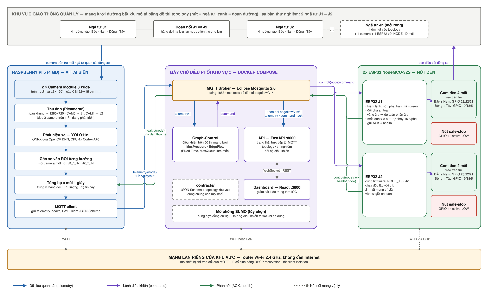
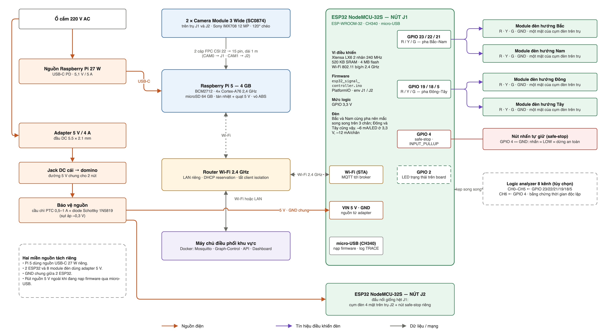
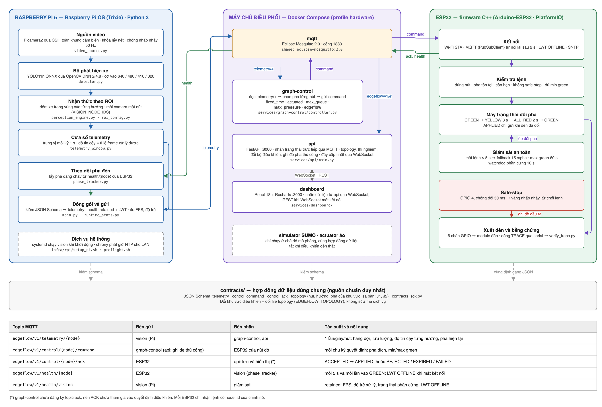
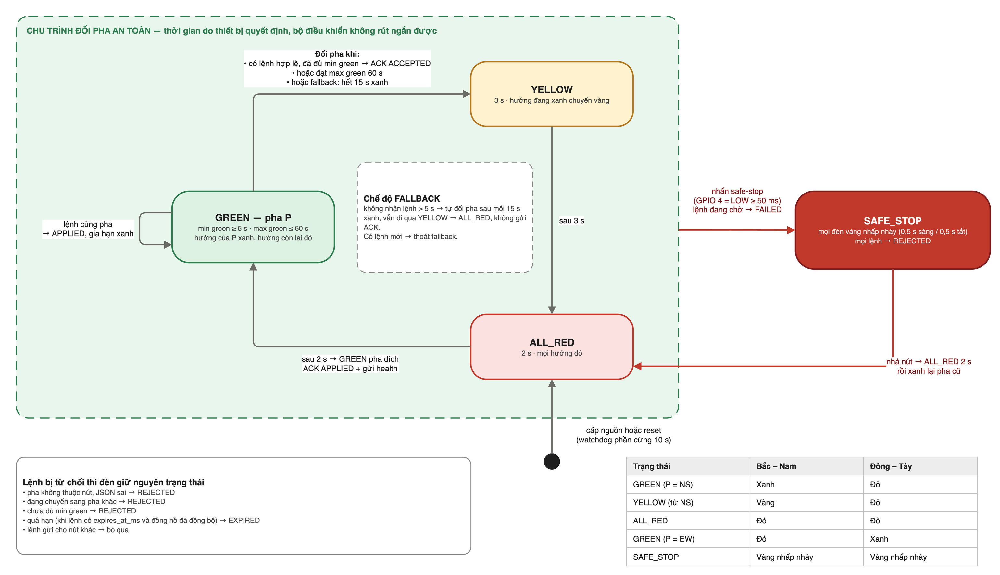

# 3.3. Mô hình hệ thống / Kiến trúc thiết kế

EdgeFlow AI là một vòng điều khiển kín trên một khu vực giao thông được quản lý. Khu vực có thể là mạng lưới đường bất kỳ, mô tả bằng một đồ thị: mỗi nút là một ngã tư, mỗi cạnh là một đoạn đường. Sa bàn thử nghiệm của đội là một khu vực như vậy, gồm hai ngã tư J1 – J2. Vòng điều khiển gồm các bước:

1. Camera trên trụ giao thông của mỗi ngã tư quan sát dòng xe.
2. Raspberry Pi 5 ước lượng hàng đợi từng hướng.
3. Bộ điều khiển trên đồ thị chọn pha đèn.
4. ESP32 tại mỗi ngã tư thực thi pha đèn trên module LED, có ràng buộc an toàn.
5. Pha đèn mới làm dòng xe trên sa bàn thay đổi, và các camera quan sát lại.

Hệ thống chia thành ba tầng. Các tầng chỉ trao đổi với nhau qua MQTT trên một mạng LAN riêng. Mọi bản tin tuân theo một hợp đồng dữ liệu chung (`contracts/`).

*Hình 3.1. Sơ đồ khối tổng thể của EdgeFlow AI*

**Tầng AI tại biên (Raspberry Pi 5).**

- Mỗi ngã tư có một trụ giao thông, giống hạ tầng thật. Đầu cần của trụ mang một Camera Module 3 Wide (góc nhìn 120°), ống kính cao 400 mm, nhìn thẳng xuống tâm ngã tư. Hai camera cắm vào hai cổng CSI của cùng một Pi 5.
- Picamera2 lấy ảnh ở chế độ toàn khung cảm biến (2304×1296), rồi thu về 1280×720.
- Mô hình YOLO11n (định dạng ONNX, chạy bằng OpenCV DNN trên CPU) phát hiện xe. Mỗi xe được gán vào vùng quan tâm (ROI) của hướng tương ứng, đặt tên theo topology: J1_N_IN … J2_W_IN. Mỗi camera chỉ báo cho nút của mình. Việc đọc hai camera trên một Pi đang được phát triển.
- Mỗi giây, Pi gửi một bản tin telemetry cho mỗi nút. Các số liệu là trung vị của mọi khung hình trong kỳ. Độ tin cậy là tỉ lệ khung hình xử lý được.
- Pha đèn ghi trong telemetry lấy từ bản tin health do chính ESP32 báo, không tự suy đoán.

**Tầng điều phối (máy chủ điều phối của khu vực, Docker Compose).**

- Broker MQTT Mosquitto chuyển mọi bản tin.
- Dịch vụ Graph-Control đọc telemetry của mọi nút trong khu vực và chọn pha cho từng nút. Bộ điều khiển đề xuất là MaxPressure và EdgeFlow; Fixed-Time và MaxQueue dùng làm mốc so sánh. Sau đó Graph-Control gửi lệnh `control/{node}/command`.
- API (FastAPI) theo dõi trực tiếp các topic telemetry, command và ack trên MQTT. API đẩy trạng thái mạng lên Dashboard (React) qua WebSocket, và Dashboard chuyển sang đọc REST khi WebSocket mất kết nối. API còn cho phép đổi bộ điều khiển và ghi đè pha thủ công.
- Graph-Control đọc topology của khu vực từ `contracts/` (biến `EDGEFLOW_TOPOLOGY`). Vì vậy muốn điều khiển một khu vực khác thì chỉ cần thay file topology và lắp thêm camera, ESP32 cho các ngã tư mới, không phải sửa mã dịch vụ.
- Cùng hợp đồng dữ liệu đó, tầng điều phối có thể chạy với SUMO thay cho camera để thử nghiệm mô phỏng.

**Tầng chấp hành (2× ESP32 NodeMCU-32S).**

- Mỗi ESP32 điều khiển 4 module đèn của một ngã tư, ghép thành cụm đèn 4 mặt treo trên trụ: Bắc và Nam dùng chung 3 chân, Đông và Tây dùng chung 3 chân.
- ESP32 kiểm tra lệnh rồi tự thực hiện chu trình đổi pha an toàn.
- ESP32 phản hồi trạng thái thực hiện lệnh qua `control/{node}/ack` và báo sức khỏe định kỳ qua `health/{node}`.
- Mỗi nút có nút safe-stop riêng và tự chạy chế độ dự phòng khi mất liên lạc.

*Hình 3.2. Kiến trúc phần cứng và sơ đồ đấu nối*

Phần cứng gồm hai miền nguồn tách riêng:

- Pi 5 dùng nguồn USB-C 27 W.
- Hai ESP32 và 8 module đèn dùng chung adapter 5 V/4 A, qua cầu chì tự phục hồi và diode Schottky 1N5819 (sụt áp ~0,3 V).

Module đèn có sẵn trở hạn dòng. Ở mức 3,3 V, mỗi LED tiêu thụ khoảng 6 mA, nên mỗi chân GPIO nuôi hai module chỉ khoảng 12 mA.

Nút safe-stop nối GPIO 4 xuống GND, dùng điện trở kéo lên nội (active-LOW). Logic analyzer 8 kênh (tùy chọn) kẹp song song lên 7 chân để có bằng chứng thời gian độc lập với phần mềm.

Bố trí tổng thể, sơ đồ nguyên lý và cách đi dây chi tiết nằm ở Phụ lục A (Hình A.1–A.4).

*Hình 3.3. Kiến trúc phần mềm và các topic MQTT*

Các dịch vụ không gọi trực tiếp mã của nhau mà chỉ trao đổi qua MQTT/HTTP. Mọi schema, topic và mã định danh nút/pha nằm trong `contracts/`. Nhờ vậy:

- Bộ điều khiển không cần biết dữ liệu đến từ camera hay từ SUMO.
- Bộ chấp hành ảo và ESP32 dùng chung một giao diện lệnh.

Khi camera mất tín hiệu, hệ thống báo thiếu dữ liệu, không thay bằng số liệu giả định.

*Hình 3.4. Máy trạng thái an toàn trong firmware ESP32*

Thời gian an toàn do thiết bị quyết định; bộ điều khiển chỉ được kéo dài, không được rút ngắn:

| Ràng buộc | Giá trị |
|---|---|
| Đèn vàng | 3 s |
| Đỏ toàn phần | 2 s |
| Xanh tối thiểu | 5 s |
| Xanh tối đa | 60 s |

Bản tin ACK phân biệt hai mốc: ACCEPTED (lệnh được nhận) và APPLIED (đèn đã thực sự đổi).

Hai cơ chế giám sát:

- **Mất liên lạc:** không nhận lệnh quá 5 s thì nút chuyển sang chu kỳ cố định 15 s xanh mỗi pha.
- **Treo chương trình:** watchdog phần cứng 10 s khởi động lại vi điều khiển về trạng thái đỏ toàn phần.

Mỗi lần đầu ra đổi trạng thái, firmware in một dòng TRACE qua cổng serial. Script `verify_trace.py` dùng các dòng này để kiểm tra vi phạm thời gian.

---

## Ghi chú cho đội (không đưa vào báo cáo)

- Hình lấy từ file `EdgeFlow_3.3_kien_truc.drawio`, gồm 4 trang tương ứng 4 hình. Ảnh PNG có nhúng sơ đồ, nên kéo thả file PNG vào draw.io vẫn sửa được.
- Các số liệu trong hình bám code ngày 10/10/2026 (`main` + phần chưa commit của Hiển). Nếu code đổi thì sửa hình theo.
- **Sửa ngày 11/10 theo góp ý của Bảo Lâm** (ảnh tin nhắn trong `_ghi_chu/gop_y_3.3_Bao_Lam_2026-10-11_*.png`):
  - Vẽ cho trường hợp triển khai thực tế, bỏ mọi chi tiết về laptop. Khối laptop đổi thành "máy chủ điều phối khu vực"; bỏ IP cố định của laptop/Pi, chữ "cho demo", dây USB từ laptop sang ESP32.
  - Sa bàn được coi là một khu vực giao thông bất kỳ: thêm ô "Ngã tư Jn (mở rộng)" nét đứt. Code đã hỗ trợ điều này: graph-control nạp topology theo `EDGEFLOW_TOPOLOGY`, và `contracts/topology/` trên `origin/main` đã có `grid4x4`, `hcm_corridor`, `cologne8`…
  - Pi nối mạng bằng Wi-Fi, bỏ "Ethernet (khuyến nghị)".
  - Mũi tên MQTT → API đổi sang nét liền. Bảo Lâm nói chưa push, nhưng `origin/main` (commit `a3f5aee`, 11/10) đã có: API đăng ký `edgeflow/v1/#`, lưu telemetry và ack, gửi command khi ghi đè thủ công; dashboard dùng WebSocket, REST làm dự phòng. Local `main` của Hiển chưa pull các commit này.
  - Vẫn đúng theo code: graph-control **chưa đăng ký** topic ack (footnote bảng H3.3); API nhận cả `health/#` nhưng chưa xử lý.
  - Bản `.drawio` trước khi sửa lưu ở `_ghi_chu/EdgeFlow_3.3_kien_truc_truoc_gop_y_Bao_Lam_2026-10-11.drawio`. Nếu Công Thịnh đã sửa bản riêng thì chép tay các thay đổi trên sang.
- **Hai camera trên một Pi (11/10) chưa có trong code.** `services/vision/video_source.py` gọi `Picamera2()` không truyền `camera_num`, nên chỉ mở được camera 0. `main.py` dùng `client_id` MQTT cố định (`vision-raspberry-pi-service`) và topic health cố định `edgeflow/v1/health/vision`. Vì vậy hai tiến trình vision chạy song song sẽ đá nhau khỏi broker, và health của tiến trình này ghi đè health của tiến trình kia. Phải sửa ba chỗ đó (hoặc cho một tiến trình đọc cả hai camera) trước khi demo. Plan (2) chốt phạm vi "1 Pi + 1 camera", nên đây là thay đổi phạm vi cần cả đội đồng ý.
- Đề xuất vòng sơ khảo mô tả Jetson Orin Nano, 5G/6G và RL trên từng nút; kiến trúc hiện tại thì khác. Plan (2) khuyên giữ một bảng đối chiếu giữa đề xuất và nguyên mẫu. Đội cân nhắc thêm một đoạn ngắn giải thích lý do đổi.
