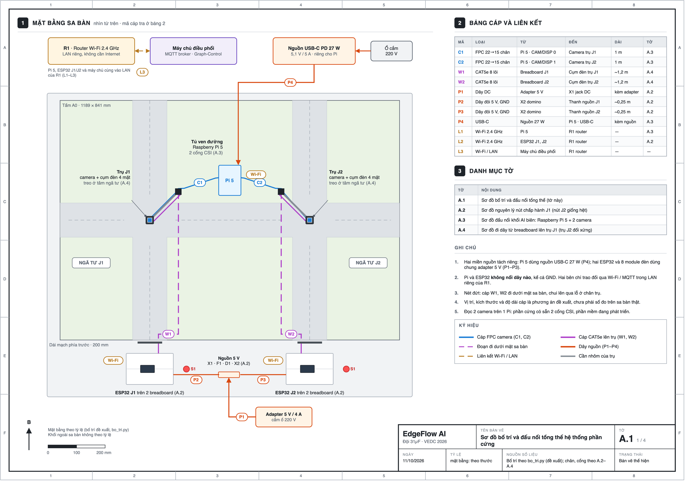
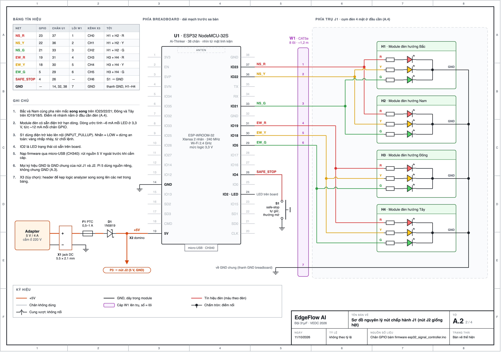
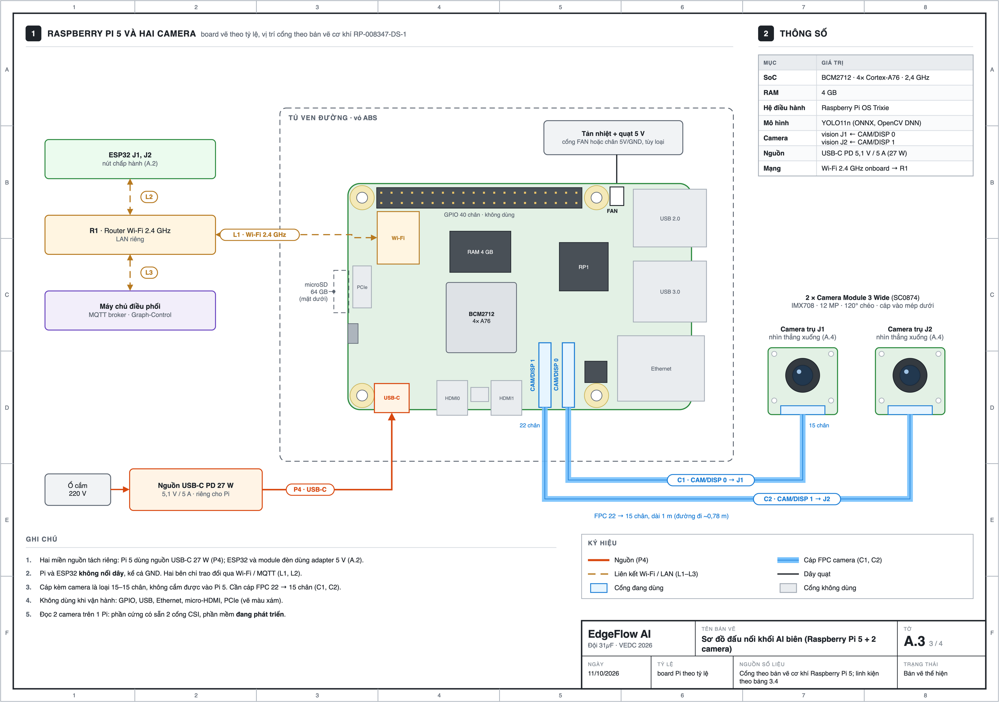
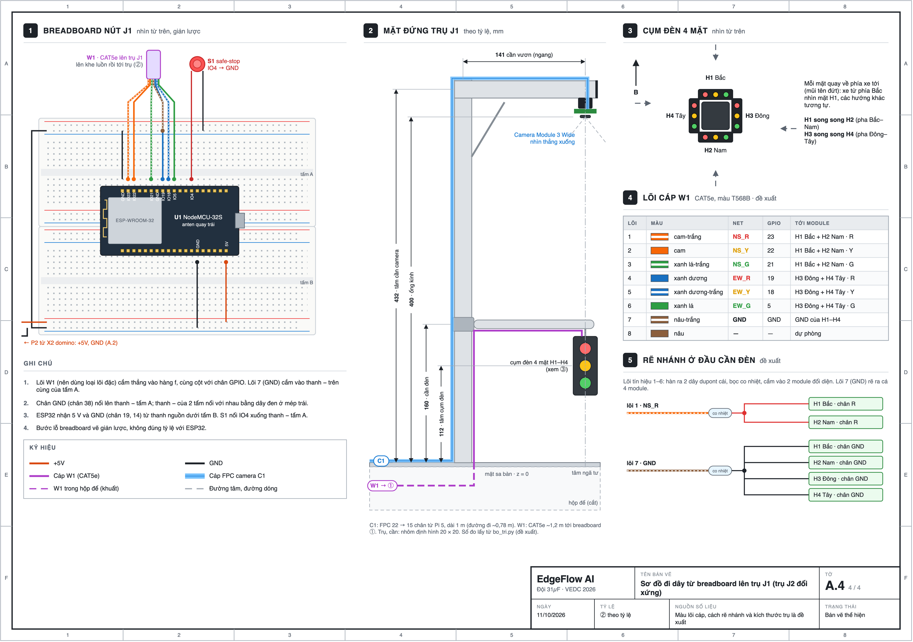

# Phụ lục A. Bản vẽ mạch

Phụ lục này chi tiết hóa Hình 3.2 thành bốn tờ bản vẽ:

- **Hình A.1:** sơ đồ bố trí và đấu nối tổng thể của toàn bộ phần cứng trên sa bàn.
- **Hình A.2:** sơ đồ nguyên lý của một nút chấp hành. Hai nút J1 và J2 đấu giống hệt nhau.
- **Hình A.3:** sơ đồ đấu nối khối AI tại biên.
- **Hình A.4:** cách đi dây từ breadboard lên trụ giao thông.

Số chân GPIO trên hình lấy trực tiếp từ firmware `esp32_signal_controller.ino`. Script sinh hình sẽ dừng lại nếu bản vẽ và firmware lệch nhau.

*Hình A.1. Sơ đồ bố trí và đấu nối tổng thể hệ thống phần cứng*

**Mặt bằng.** Hình vẽ theo tỷ lệ mặt bằng sa bàn: tấm A0 với hai ngã tư J1, J2, và dải mạch rộng 200 mm ở phía trước.

- Mỗi ngã tư có một trụ ở góc phía Bắc. Camera và cụm đèn 4 mặt treo ở đầu cần, ngay trên tâm ngã tư.
- Raspberry Pi 5 đặt trong tủ ven đường, giữa hai trụ.
- Hai ESP32 cắm trên breadboard ở dải mạch phía trước, cùng bộ nguồn 5 V.

**Bảng cáp.** Mỗi đường nối mang một mã:

- C1, C2: cáp camera;
- W1, W2: cáp lên trụ;
- P1–P4: dây nguồn;
- L1–L3: liên kết Wi-Fi.

Bảng cáp trên hình ghi điểm đầu, điểm cuối, độ dài và tờ chi tiết của từng mã.

**Hai miền nguồn.** Pi 5 dùng nguồn USB-C riêng. Hai ESP32 và tám module đèn dùng chung một adapter 5 V. Pi và ESP32 không có dây nào nối với nhau; hai bên chỉ trao đổi qua Wi-Fi và MQTT trong mạng LAN riêng của router.

*Hình A.2. Sơ đồ nguyên lý nút chấp hành J1 (nút J2 giống hệt)*

**Nguồn.** Adapter 5 V/4 A cấp nguồn qua jack DC (X1), cầu chì tự phục hồi PTC (F1) và diode Schottky 1N5819 (D1) để chống cắm ngược cực. Sau đó domino (X2) chia nguồn tới chân 5V/VIN của hai ESP32. GND của hai nút nối chung.

**Ngõ ra đèn.** Mỗi nút có 4 module đèn H1–H4, ghép thành cụm đèn 4 mặt trên trụ.

- Hướng Bắc và Nam cùng pha nên mắc song song trên ba chân GPIO 23/22/21 (đỏ/vàng/xanh).
- Hướng Đông và Tây mắc song song trên GPIO 19/18/5.
- Tín hiệu đi lên trụ qua cáp W1, mỗi tín hiệu một lõi. Việc rẽ nhánh ra hai module làm ở đầu cần đèn.
- Module đã có sẵn trở hạn dòng. Dòng ước tính khoảng 6 mA mỗi LED ở 3,3 V, tức khoảng 12 mA mỗi chân GPIO.

**An toàn và đo kiểm.**

- **Nút safe-stop (S1):** nút tự giữ nối GPIO 4 xuống GND, dùng điện trở kéo lên nội. Khi nhấn, chân xuống mức thấp; nút chuyển sang vàng nhấp nháy và từ chối lệnh.
- **Header X3 (tùy chọn):** để kẹp logic analyzer song song lên 7 tín hiệu. Bản ghi từ logic analyzer là bằng chứng thời gian độc lập với phần mềm.

*Hình A.3. Sơ đồ đấu nối khối AI tại biên (Raspberry Pi 5 và hai camera)*

**Board.** Raspberry Pi 5 vẽ theo tỷ lệ. Vị trí các cổng lấy từ bản vẽ cơ khí của Raspberry Pi. Cổng không dùng khi vận hành vẽ màu xám.

**Nguồn và camera.**

- Raspberry Pi 5 dùng nguồn USB-C 27 W riêng.
- Hai Camera Module 3 Wide gắn trên hai trụ J1 và J2. Camera J1 nối vào cổng CAM/DISP 0, camera J2 vào cổng CAM/DISP 1.
- Cáp nối là loại FPC 22 → 15 chân dài 1 m. Cáp kèm theo camera là loại 15–15 chân, không cắm được vào Pi 5.

**Liên lạc với ESP32.** Pi và các ESP32 không có dây nào nối với nhau, kể cả GND. Hai bên chỉ trao đổi qua Wi-Fi và MQTT trong mạng LAN riêng của router.

Phần cứng đã có đủ hai cổng camera. Phần mềm đọc đồng thời hai camera trên một Pi đang được phát triển.

*Hình A.4. Sơ đồ đi dây từ breadboard lên trụ giao thông J1 (trụ J2 đối xứng)*

**Breadboard.** ESP32 cắm bắc cầu qua khe giữa hai tấm breadboard, anten quay sang trái để hàng chân tín hiệu nằm về phía cáp W1. Các lõi của cáp W1 (CAT5e, 8 lõi, dài khoảng 1,2 m) cắm thẳng vào breadboard, cùng cột với chân GPIO tương ứng.

**Đường cáp lên trụ.** Cáp W1 đi dưới mặt sa bàn, lên theo trụ, dọc mặt dưới cần đèn, rồi tới cụm đèn 4 mặt.

- Ở đầu cần, mỗi lõi tín hiệu rẽ ra hai module đối diện.
- Cáp camera C1 đi theo mặt bên kia của trụ, dọc lưng cần trên, tới camera.

**Những điểm là đề xuất, chưa phải số đo trên sa bàn thật:**

- màu lõi cáp theo chuẩn T568B;
- cách rẽ nhánh ở đầu cần;
- các kích thước của trụ và vị trí trên mặt bằng.

---

## Ghi chú cho đội (không đưa vào báo cáo)

- **Nguồn của hình:**
  - Bốn hình lấy từ `EdgeFlow_ban_ve_mach.drawio` (4 trang). File này sinh bằng `_scripts/tao_drawio_ban_ve_mach.py`; mỗi tờ một module `_scripts/to_a1_tong_the.py` … `to_a4_tru.py`, phần dùng chung ở `_scripts/ban_ve_mach_chung.py`.
  - Xuất PNG/SVG bằng `_scripts/xuat_hinh_ban_ve_mach.sh`.
  - Spec: `_ghi_chu/2026-10-11-ban-ve-mach-design.md`.
  - Script **không ghi đè** file `.drawio` đã có, trừ khi chạy với `--ghi-de`. Sửa trực tiếp trên draw.io là được.
- **Vẽ lại ngày 11/10/2026 tối** theo yêu cầu của Hiển:
  - thêm tờ tổng thể A.1, nên các tờ cũ A.1–A.3 thành A.2–A.4 và đổi tên file PNG;
  - mọi tờ có khung bản vẽ kỹ thuật (lưới ô 1–8 × A–F) và khung tên.
  - Bản trước khi vẽ lại (drawio, PNG, SVG, script) lưu ở `_ghi_chu/ban_ve_mach_truoc_ve_lai_2026-10-11/`.
- **Chọn Phụ lục A thay vì chèn vào 3.3:** để không phải đánh lại số H3.3–H3.5, và để bản vẽ khổ ngang đọc được. Trong Word, phụ lục nằm ở một section khổ ngang, ảnh rộng 24 cm.
- **Dây trên hình là đường tự do, không gắn vào ký hiệu.** Khi kéo một ký hiệu trong draw.io thì phải kéo dây theo.
- **Nhãn CAM/DISP 0/1 trên A.3** đọc từ ảnh sản phẩm chính thức của Raspberry Pi: đầu nối gần HDMI là CAM/DISP 1, gần Ethernet là CAM/DISP 0. Nên nhìn lại chữ in trên board thật khi cắm cáp.
- **A.4 đổi cách cắm so với bản cũ:** ESP32 quay anten sang trái và lõi W1 cắm thẳng vào cột của chân GPIO, không cần dây nhảy. Lõi 7 (GND) cắm vào thanh − tấm A, thanh này nối chân GND 38. Đây vẫn là đề xuất; nếu cả đội đã cắm kiểu khác thì vẽ lại khối ①.
- **Độ dài P2, P3 (~0,25 m) trên bảng cáp A.1** tính từ bố trí trong `bo_tri.py`, không phải số đo.
- **`vedc-traffic-flow/src/hardware/schematic_and_pinout.md` mục 1–2 lệch code.** Mục 1 ghi trở 220 Ω trên mỗi chân và kéo lên 10 kΩ; mục 2 vẽ thêm ULN2803. Mục 3.4 của chính file đó và firmware thì nói: module đèn đã có trở, safe-stop dùng `INPUT_PULLUP` nội. Hình A.2 theo firmware. File nằm trong repo chung, đội quyết có sửa không.
- **GPIO 5 là chân strapping của ESP32.** Đèn xanh Đông–Tây (EW_G) có thể nháy lúc ESP32 khởi động. Phải kiểm trên mạch thật; nếu có nháy thì ghi vào báo cáo hoặc đổi chân trong firmware (cả đội quyết).
- **Bảo vệ nguồn dùng chung một bộ PTC + 1N5819 cho cả 2 nút**, giống H3.2. Bảng linh kiện có đủ diode (5) và PTC (4) nếu sau này muốn mỗi nút một bộ.
- **Thứ tự chân NodeMCU-32S** đối chiếu với trang linh kiện LCSC/Flux "NodeMCU-32S". Nếu board mua về là loại khác (ví dụ DevKitC 30 chân) thì phải vẽ lại U1 trên A.2 và khối ① trên A.4.
