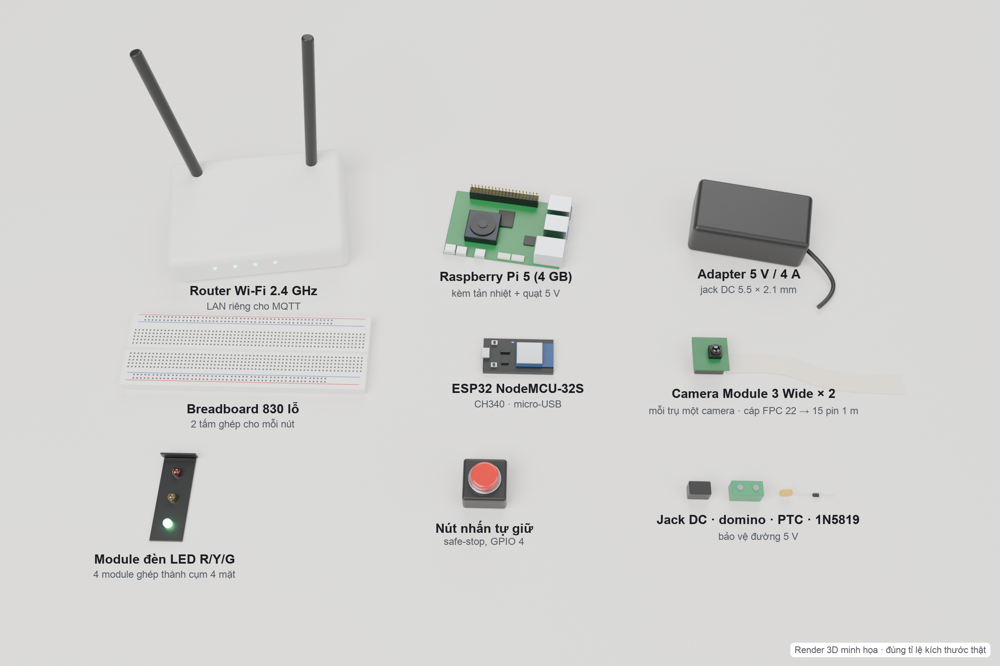

# 3.4. Công cụ, linh kiện và công cụ thiết kế (EDA tool): phần linh kiện

Linh kiện được chọn theo ba tiêu chí: mua được trong nước, giá thấp, và đủ để chứng minh ba điểm trên phần cứng thật:

1. AI chạy được tại biên.
2. Đèn đổi pha đúng ràng buộc an toàn.
3. Hệ thống vẫn an toàn khi mất liên lạc.

*Hình 3.5. Các linh kiện chính của nguyên mẫu (render 3D đúng tỉ lệ kích thước thật)*

**Bảng 3.1. Danh mục linh kiện**

| STT | Linh kiện | Mã / thông số chính | SL | Vai trò |
|---|---|---|---|---|
| **A** | **Khối AI tại biên** | | | |
| 1 | Raspberry Pi 5 (4 GB RAM) | BCM2712, 4× Cortex-A76 2,4 GHz; Wi-Fi, Gigabit Ethernet | 1 | Chạy YOLO11n, gán xe vào ROI, gửi telemetry qua MQTT |
| 2 | Camera Module 3 Wide (SC0874) | Sony IMX708 12 MP; góc nhìn chéo 120° (102° × 67°); lấy nét tự động; CSI | 2 | Mỗi trụ giao thông một camera, nhìn thẳng xuống ngã tư của mình |
| 3 | Cáp camera cho Pi 5 | FPC 22 → 15 pin; dài 1 m (đường cáp ~0,8 m mỗi bên) | 2 | Nối 2 camera với 2 cổng CAM0 / CAM1 của Pi 5 (cáp kèm camera là loại 15–15, không cắm được) |
| 4 | Thẻ nhớ microSD | 64 GB | 1 | Hệ điều hành, mã nguồn, model ONNX |
| 5 | Tản nhiệt nhôm kèm quạt | 5 V DC, 0,65 W | 1 | Tránh hạ xung khi suy luận liên tục |
| 6 | Vỏ ABS cho Pi 5 | 35 × 91 × 62 mm | 1 | Bảo vệ bo mạch; đặt ven đường giữa hai trụ như tủ điều khiển |
| 7 | Nguồn USB-C cho Pi 5 | 5,1 V / 5 A (27 W) | 1 | Nguồn riêng cho Pi |
| **B** | **Khối chấp hành (nút đèn)** | | | |
| 8 | ESP32 NodeMCU-32S | ESP-WROOM-32, 2 nhân 240 MHz, Wi-Fi 2.4 GHz; CH340, micro-USB | 3 (2 + 1 dự phòng) | Bộ điều khiển đèn cục bộ cho J1 và J2 |
| 9 | Module đèn LED R/Y/G | 4 chân R-Y-G-GND, có sẵn trở hạn dòng | 10 (8 + 2 dự phòng) | 4 module mỗi nút ghép thành cụm đèn 4 mặt treo trên trụ |
| 10 | Nút nhấn tự giữ (safe-stop) | Thường mở, GPIO 4 ↔ GND | 3 (2 + 1 dự phòng) | Dừng an toàn tại chỗ |
| 11 | Breadboard | 830 lỗ, 165 × 55 mm | 4 | Mỗi nút ghép 2 tấm |
| 12 | Dây dupont | 40 sợi; M-M, M-F, F-F; 20 cm và 30 cm | 5 bộ | Nối ESP32 với đèn và nút |
| 13 | Cáp 8 lõi lên trụ | Ví dụ cáp mạng CAT5e, ~1,2 m; dùng 7 lõi (R/Y/G × 2 pha + GND) | 2 | Nối ESP32 với cụm đèn: đi dưới sa bàn rồi theo trụ |
| 14 | Cáp micro-USB truyền dữ liệu | Loại có đường dữ liệu | 3 | Nạp firmware, đọc log TRACE |
| **C** | **Nguồn và bảo vệ** | | | |
| 15 | Adapter | 5 V / 4 A, đầu DC 5.5 × 2.1 mm | 1 | Cấp nguồn cho 2 ESP32 và 8 module đèn |
| 16 | Jack DC cái ra domino | 5.5 × 2.1 mm | 2 | Lấy 5 V ra đường nguồn chung |
| 17 | Diode Schottky 1N5819 | 1 A, sụt áp ~0,3 V | 5 | Chống ngược cực |
| 18 | Cầu chì tự phục hồi PTC | 0,5–1 A | 4 | Bảo vệ quá dòng |
| **D** | **Mạng và điều phối** | | | |
| 19 | Router Wi-Fi | 2.4 GHz, WPA2, DHCP reservation | 1 | LAN riêng cho MQTT, không cần Internet |
| 20 | Cáp mạng LAN | 1–2 m | 1 | Nối Pi với router |
| 21 | Laptop của đội | Docker Compose | 1 | Broker, Graph-Control, API, Dashboard |
| **E** | **Sa bàn và đo kiểm** | | | |
| 22 | Foam PVC A0 + decal mặt đường | 1189 × 841 mm, 2 ngã tư | 1 | Mặt bằng thí nghiệm |
| 23 | Xe mô hình | Tỉ lệ 1:64, dài ~70–75 mm | 20–30 | Tạo hàng đợi có kiểm soát |
| 24 | Trụ giao thông | Đề xuất: nhôm định hình 20 × 20, trụ cao ~440 mm, cần vươn ~140 mm; ống kính cao 400 mm | 2 | Mỗi ngã tư một trụ: giữ camera cố định, treo cụm đèn 4 mặt |
| 25 | Logic analyzer (tùy chọn) | USB 8 kênh, 24 MHz, PulseView | 1 | Đo độc lập thời gian vàng, đỏ toàn phần |
| 26 | Đèn LED chiếu sa bàn | Không nhấp nháy | 1 | Ổn định ánh sáng cho camera |

Một số lựa chọn thiết kế:

- **Mỗi ngã tư một trụ giao thông, một camera.** Hạ tầng thật không có một camera nhìn toàn mạng, nên camera đặt trên trụ đèn của từng ngã tư. Bản Wide (120°) cho phép ống kính chỉ cao 400 mm mà vẫn thấy đủ 4 làn vào của ngã tư. Hai camera cắm vào hai cổng CSI của cùng một Pi 5, nên vẫn chỉ cần một Pi.
- **Cụm đèn 4 mặt trên trụ.** 4 module đèn của mỗi nút ốp quanh một lõi, treo ở tâm ngã tư bằng cần đèn của trụ. Cách đấu dây trên ESP32 giữ nguyên.
- **Đấu đèn song song.** Hai hướng cùng pha (Bắc–Nam, Đông–Tây) mắc song song. Mỗi ESP32 chỉ cần 6 chân GPIO cho đèn, mỗi chân kéo khoảng 12 mA, nằm trong giới hạn an toàn của ESP32.
- **Diode Schottky 1N5819 thay cho 1N4007.** 1N4007 sụt khoảng 0,8 V, làm chân VIN của ESP32 chỉ còn khoảng 4,2 V. 1N5819 chỉ sụt khoảng 0,3 V.
- **Bỏ cảm biến hồng ngoại và relay.** Đề xuất ban đầu có hai linh kiện này, nhưng kế hoạch đã điều chỉnh: thị giác máy tính là đường đo chính, còn relay một kênh không chứng minh được khả năng tương thích với tủ đèn thật.

---

## Ghi chú cho đội (không đưa vào báo cáo)

- Số lượng lấy theo `MUA_SAM_CON_THIEU.md` (04/10). **Kiểm lại** những món đã thực sự mua và lắp, bỏ những dòng không dùng. Hai món chỉ nên giữ khi đã có thật: logic analyzer (25) và đèn chiếu (26).
- Trụ nhôm 20 × 20 là phương án đề xuất để vẽ render (thay giá treo chữ L ngày 11/10 theo đề nghị của Công Thịnh). Nếu đội làm trụ bằng vật liệu khác, sửa dòng 24 và chú thích hình.
- **Đổi so với danh sách mua 04/10:** camera 1 → 2; cáp camera 300 + 500 mm → 2 sợi 1 m; thêm 2 sợi cáp 8 lõi lên trụ. Cáp 22 → 15 pin dài 1 m ít phổ biến hơn loại 300/500 mm, cần tìm nguồn và thử ảnh ổn định ở độ dài này. Nếu không mua được, hạ trụ hoặc dời Pi lại gần trụ rồi tính lại đường cáp (`bo_tri.csi_route`).
- Pi chạy YOLO cho hai luồng camera nên FPS mỗi luồng sẽ giảm khoảng một nửa so với một camera. Cần đo lại bằng `benchmark.py`.
- Bảng không ghi đơn giá, vì hai báo giá 19/09 đã hết hạn. Nếu mẫu báo cáo yêu cầu dự toán, lấy theo báo giá mới.
- Bảng gốc dạng CSV: `bang_linh_kien.csv`.
