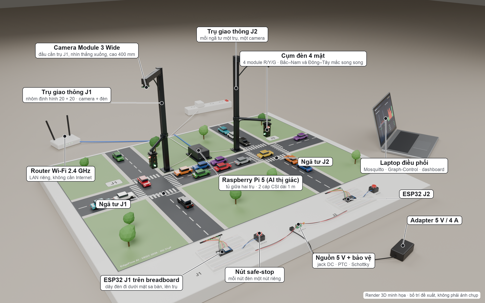
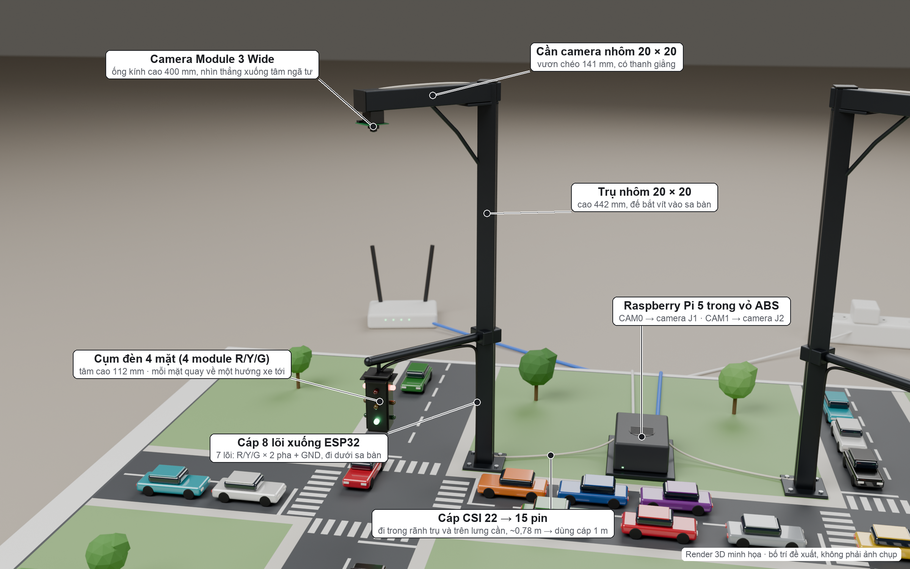
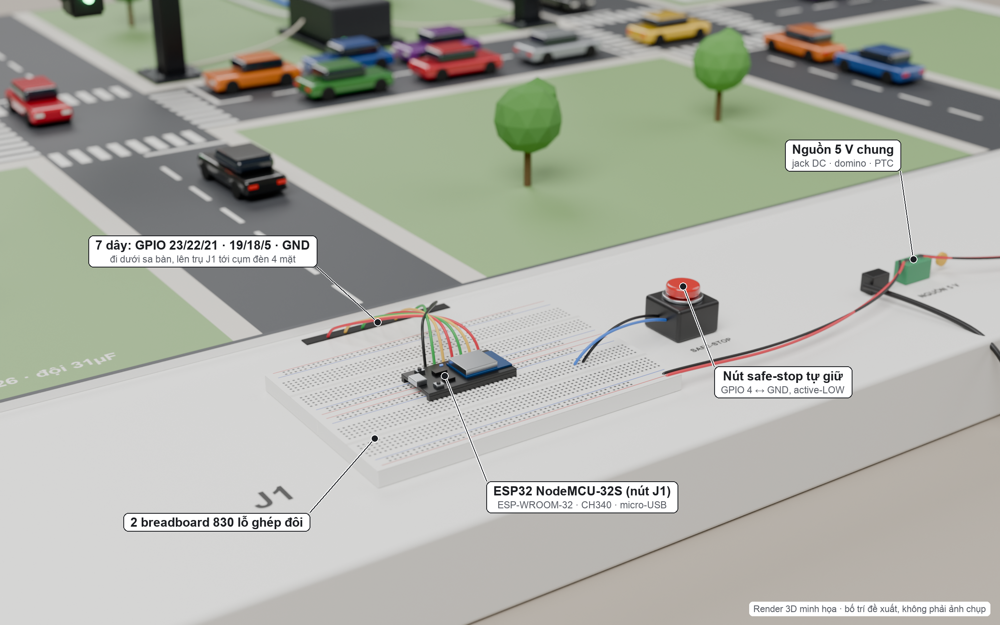
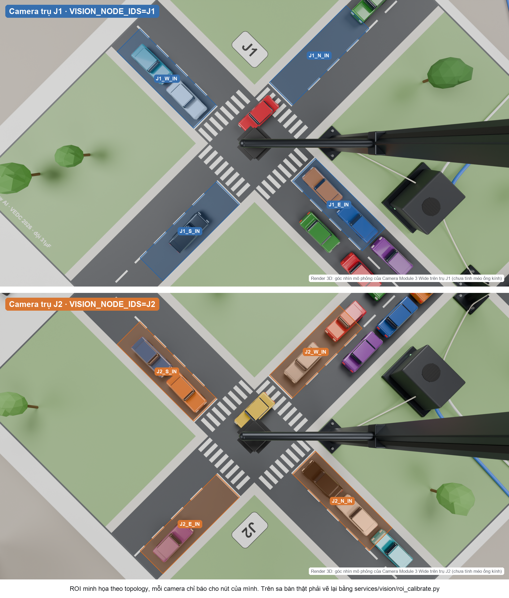
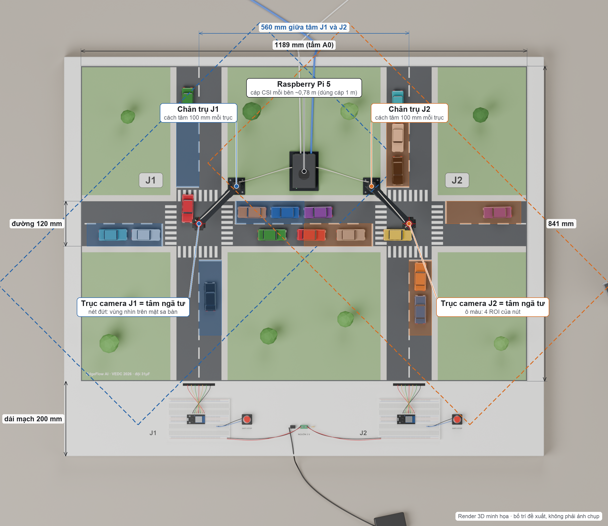
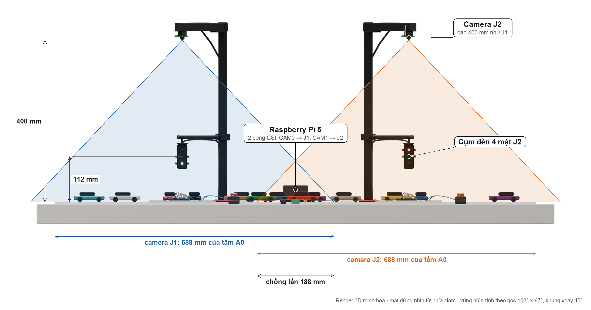

# 4.4. Hình ảnh minh họa

Các hình dưới đây là **render 3D trên Blender**, dựng theo kích thước thật của linh kiện và phương án bố trí đề xuất. Mục đích là minh họa cách lắp đặt và vùng nhìn của camera; đây không phải ảnh chụp nguyên mẫu.

Giống hạ tầng giao thông thật, mỗi ngã tư có một trụ đèn riêng. Trụ mang camera nhìn xuống ngã tư và cụm đèn 4 mặt; không có camera nào nhìn bao quát toàn mạng.

*Hình 4.1. Tổng quan sa bàn EdgeFlow AI: 2 ngã tư J1 – J2, mỗi ngã tư một trụ giao thông mang camera và cụm đèn 4 mặt, Raspberry Pi 5 đặt giữa hai trụ, 2 nút đèn ESP32 và laptop điều phối (render 3D minh họa)*

*Hình 4.2. Cận cảnh trụ giao thông J1: camera ở đầu cần, cao 400 mm; cụm đèn 4 mặt trên cần dưới; cáp CSI đi trong rãnh trụ về Pi 5 (render 3D minh họa)*

*Hình 4.3. Cận cảnh nút đèn J1: ESP32 trên breadboard, dây tín hiệu đi dưới mặt sa bàn lên trụ, nút safe-stop và đường nguồn 5 V (render 3D minh họa)*

*Hình 4.4. Góc nhìn mô phỏng của hai camera trên trụ J1 (trên) và J2 (dưới), mỗi camera kèm 4 vùng ROI của nút mình. Trụ và cần đèn lọt vào khung hình nhưng nằm ngoài ROI. Render không mô phỏng méo ống kính; ROI thật phải hiệu chỉnh trên khung hình thật*

*Hình 4.5. Bản vẽ bố trí nhìn từ trên: tấm A0 1189 × 841 mm, hai ngã tư cách nhau 560 mm, vùng nhìn (nét đứt) và ROI của từng camera, vị trí hai trụ và Pi 5*

*Hình 4.6. Mặt đứng nhìn từ phía Nam: ống kính cao 400 mm, cụm đèn cao 112 mm; vùng nhìn của hai camera theo trục Đông – Tây và phần chồng lấn ở giữa đoạn nối*

---

## Ghi chú cho đội (không đưa vào báo cáo)

- **Mục 4.4 nằm trong phần "Kết quả đạt được đến vòng bán kết".** Render chỉ là minh họa thiết kế. Mỗi hình đã có dòng "Render 3D minh họa" ở góc, và chú thích cũng ghi rõ. Đừng xóa hai thông tin đó.
- Nên thêm **ảnh chụp thật** ngay khi có: Pi 5 chạy vision (log FPS), ESP32 nối đèn sáng đúng pha, sa bàn đã dán decal. Ảnh thật nên đứng trước, render đứng sau làm hình bổ trợ.
- Hình 4.4 **không** vẽ khung phát hiện xe. Chưa có kết quả phát hiện trên ảnh sa bàn thật, nên vẽ khung lên sẽ thành số liệu giả.
- **11/10: đổi từ giá treo chữ L (1 camera cao 730 mm) sang 2 trụ giao thông**, theo đề nghị của Công Thịnh. Số hình đổi theo: hình cận cảnh trụ là H4.2 mới, cận cảnh nút J1 lùi xuống H4.3, góc nhìn camera thành H4.4 (2 khung), bản vẽ từ trên thành H4.5, mặt đứng thành H4.6.
- Các con số 400 mm (ống kính), 112 mm (cụm đèn), trụ cách tâm ngã tư 100 mm, 560 mm và 120 mm là **phương án đề xuất** trong `blender/bo_tri.py`. Ống kính phải cao ít nhất ~382 mm thì mới thấy trọn 4 ROI dài 200 mm của nút (`bo_tri.camera_cover_h`), nên đừng hạ trụ khi chưa rút ngắn ROI. Sa bàn thật khác thì sửa file đó rồi dựng lại (xem README).
- Camera xoay 45° theo cần trụ. Vì vậy trong khung hình, các đường đi chéo và hướng Bắc nằm chéo. ROI thật vẽ lại bằng `services/vision/roi_calibrate.py` cho từng camera.
- Bản không chú thích: `renders/H4.1_tong_quan_sa_ban_khong_chu_thich.png`. Bản không ROI: `renders/H4.4a_goc_nhin_camera_J1.png` và `renders/H4.4b_goc_nhin_camera_J2.png`. Từng khung có ROI: `H4.4a_…_ROI.png`, `H4.4b_…_ROI.png`.
- Decal mặt đường `blender/textures/decal_sa_ban.png` (4 px/mm, đúng khổ A0) có thể dùng làm bản nháp gửi tiệm in. Cần kiểm lại bề rộng làn so với xe thật trước khi in. Nhãn J1 đã dời sang góc Tây-Bắc để không bị chân trụ che.
