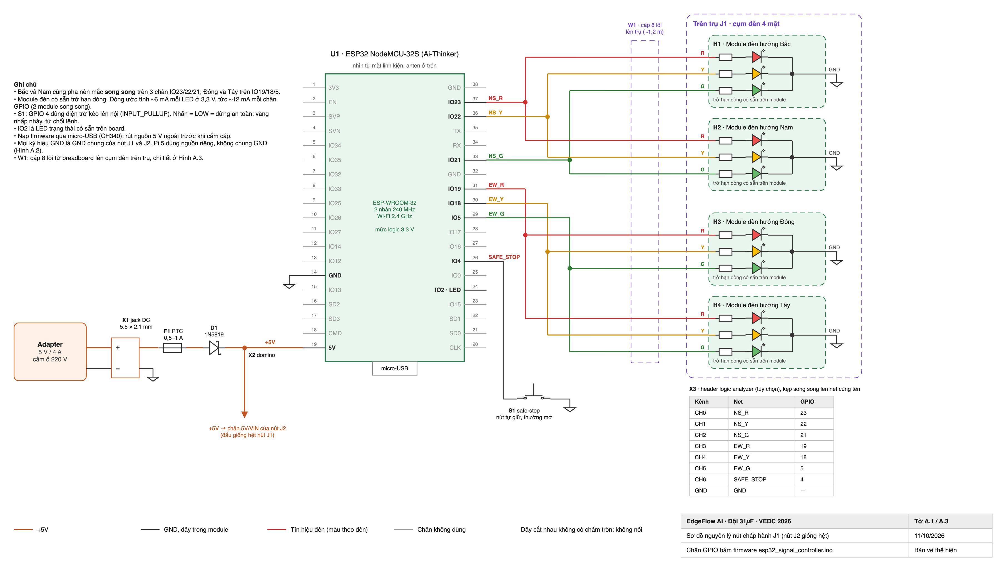
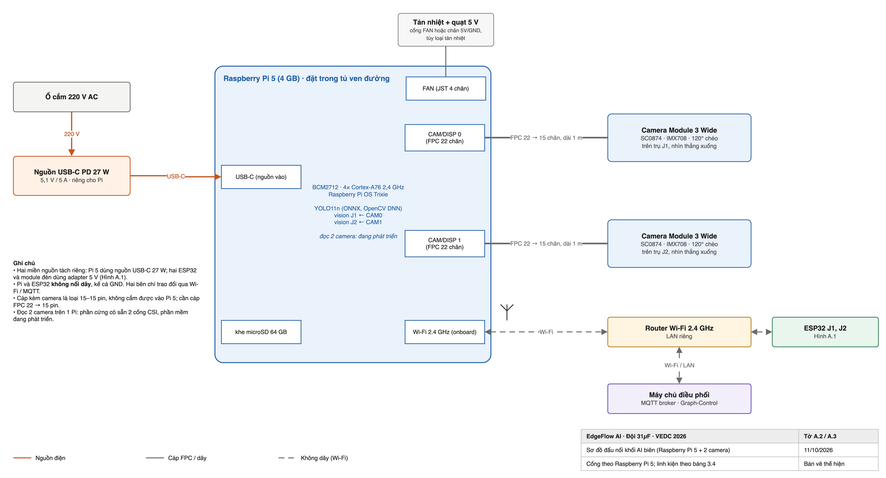
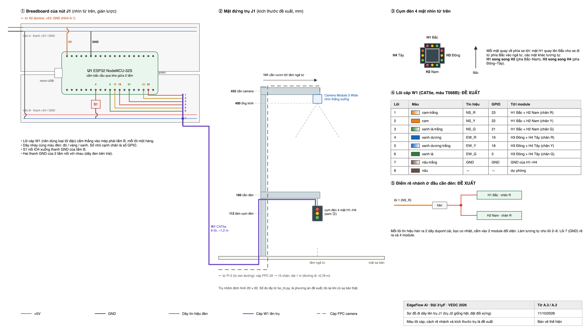

# Phụ lục A. Bản vẽ mạch

Phụ lục này chi tiết hóa Hình 3.2 thành ba tờ bản vẽ:

- **Hình A.1:** sơ đồ nguyên lý của một nút chấp hành. Hai nút J1 và J2 đấu giống hệt nhau.
- **Hình A.2:** sơ đồ đấu nối khối AI tại biên.
- **Hình A.3:** cách đi dây từ breadboard lên trụ giao thông.

Số chân GPIO trên hình lấy trực tiếp từ firmware `esp32_signal_controller.ino`. Script sinh hình sẽ dừng lại nếu bản vẽ và firmware lệch nhau.

*Hình A.1. Sơ đồ nguyên lý nút chấp hành J1 (nút J2 giống hệt)*

**Nguồn.** Adapter 5 V/4 A cấp nguồn qua jack DC (X1), cầu chì tự phục hồi PTC (F1) và diode Schottky 1N5819 (D1) để chống cắm ngược cực. Sau đó domino (X2) chia nguồn tới chân 5V/VIN của hai ESP32. GND của hai nút nối chung.

**Ngõ ra đèn.** Mỗi nút có 4 module đèn H1–H4, ghép thành cụm đèn 4 mặt trên trụ.

- Hướng Bắc và Nam cùng pha nên mắc song song trên ba chân GPIO 23/22/21 (đỏ/vàng/xanh).
- Hướng Đông và Tây mắc song song trên GPIO 19/18/5.
- Module đã có sẵn trở hạn dòng. Dòng ước tính khoảng 6 mA mỗi LED ở 3,3 V, tức khoảng 12 mA mỗi chân GPIO.

**An toàn và đo kiểm.**

- **Nút safe-stop (S1):** nút tự giữ nối GPIO 4 xuống GND, dùng điện trở kéo lên nội. Khi nhấn, chân xuống mức thấp; nút chuyển sang vàng nhấp nháy và từ chối lệnh.
- **Header X3 (tùy chọn):** để kẹp logic analyzer song song lên 7 tín hiệu. Bản ghi từ logic analyzer là bằng chứng thời gian độc lập với phần mềm.

*Hình A.2. Sơ đồ đấu nối khối AI tại biên (Raspberry Pi 5 và hai camera)*

**Nguồn và camera.**

- Raspberry Pi 5 dùng nguồn USB-C 27 W riêng.
- Hai Camera Module 3 Wide gắn trên hai trụ J1 và J2, nối vào hai cổng CAM/DISP 0 và CAM/DISP 1 bằng cáp FPC 22 → 15 chân dài 1 m. Cáp kèm theo camera là loại 15–15 chân, không cắm được vào Pi 5.

**Liên lạc với ESP32.** Pi và các ESP32 không có dây nào nối với nhau, kể cả GND. Hai bên chỉ trao đổi qua Wi-Fi và MQTT trong mạng LAN riêng của router.

Phần cứng đã có đủ hai cổng camera. Phần mềm đọc đồng thời hai camera trên một Pi đang được phát triển.

*Hình A.3. Sơ đồ đi dây từ breadboard lên trụ giao thông J1 (trụ J2 giống hệt)*

**Breadboard.** ESP32 cắm bắc cầu qua khe giữa hai tấm breadboard. Các dây nhảy cùng màu với đèn đi từ chân GPIO tới mép breadboard. Tại đó các lõi của cáp W1 (CAT5e, 8 lõi, dài khoảng 1,2 m) được cắm vào.

**Đường cáp lên trụ.** Cáp W1 đi dưới mặt sa bàn, lên theo trụ, dọc cần đèn, rồi tới cụm đèn 4 mặt.

- Ở đầu cần, mỗi lõi tín hiệu rẽ ra hai module đối diện.
- Cáp FPC của camera đi theo mặt bên kia của trụ, lên cần trên.

**Những điểm là đề xuất, chưa phải số đo trên sa bàn thật:**

- màu lõi cáp theo chuẩn T568B;
- cách rẽ nhánh ở đầu cần;
- các kích thước của trụ.

---

## Ghi chú cho đội (không đưa vào báo cáo)

- **Nguồn của hình:**
  - Ba hình lấy từ `EdgeFlow_ban_ve_mach.drawio` (3 trang). File này sinh bằng `_scripts/tao_drawio_ban_ve_mach.py` ngày 11/10/2026, xuất PNG/SVG bằng `_scripts/xuat_hinh_ban_ve_mach.sh`.
  - Spec: `_ghi_chu/2026-10-11-ban-ve-mach-design.md`.
  - Script **không ghi đè** file `.drawio` đã có, trừ khi chạy với `--ghi-de`. Sửa trực tiếp trên draw.io là được.
- **Chọn Phụ lục A thay vì chèn vào 3.3:** để không phải đánh lại số H3.3–H3.5, và để bản vẽ khổ ngang đọc được. Trong Word, phụ lục nằm ở một section khổ ngang.
- **Dây trên hình là đường tự do, không gắn vào ký hiệu.** Khi kéo một ký hiệu trong draw.io thì phải kéo dây theo.
- **`vedc-traffic-flow/src/hardware/schematic_and_pinout.md` mục 1–2 lệch code.** Mục 1 ghi trở 220 Ω trên mỗi chân và kéo lên 10 kΩ; mục 2 vẽ thêm ULN2803. Mục 3.4 của chính file đó và firmware thì nói: module đèn đã có trở, safe-stop dùng `INPUT_PULLUP` nội. Hình A.1 theo firmware. File nằm trong repo chung, đội quyết có sửa không.
- **GPIO 5 là chân strapping của ESP32.** Đèn xanh Đông–Tây (EW_G) có thể nháy lúc ESP32 khởi động. Phải kiểm trên mạch thật; nếu có nháy thì ghi vào báo cáo hoặc đổi chân trong firmware (cả đội quyết).
- **Bảo vệ nguồn dùng chung một bộ PTC + 1N5819 cho cả 2 nút**, giống H3.2. Bảng linh kiện có đủ diode (5) và PTC (4) nếu sau này muốn mỗi nút một bộ.
- **Thứ tự chân NodeMCU-32S** đối chiếu với trang linh kiện LCSC/Flux "NodeMCU-32S". Nếu board mua về là loại khác (ví dụ DevKitC 30 chân) thì phải vẽ lại U1.
